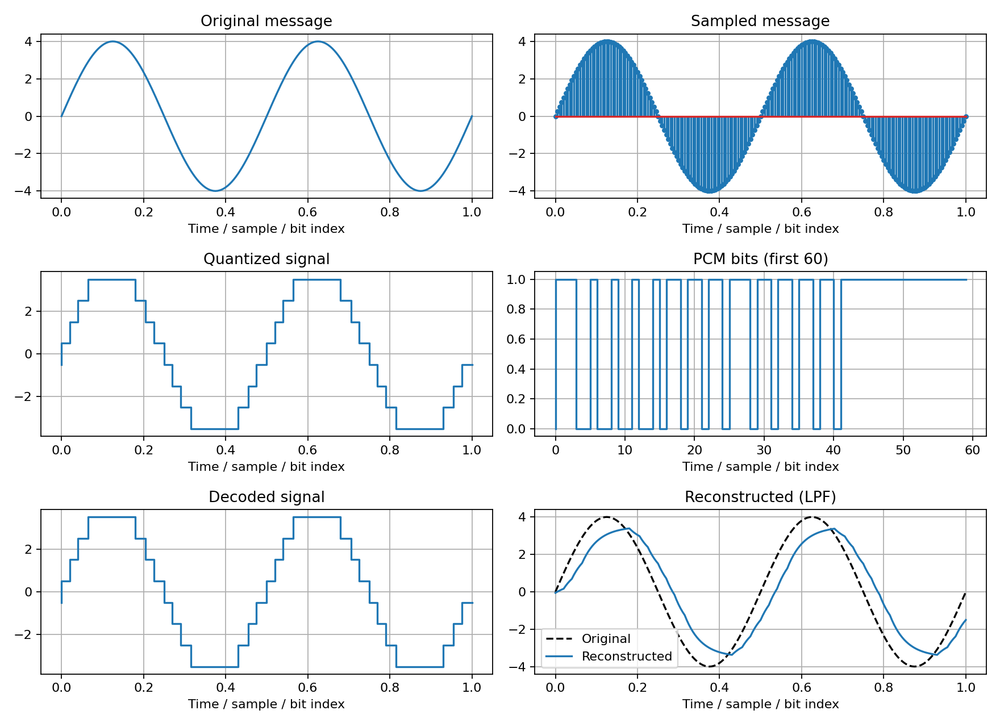
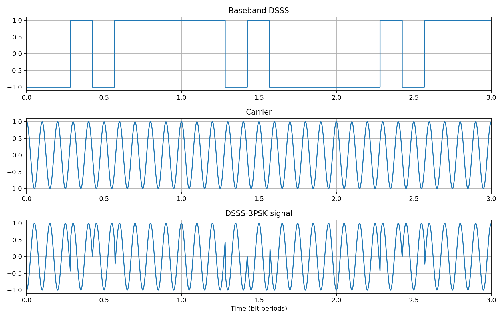
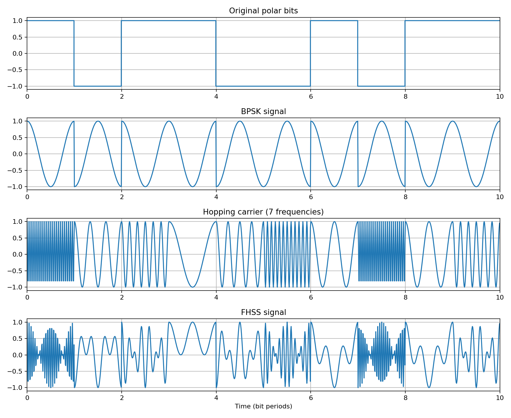
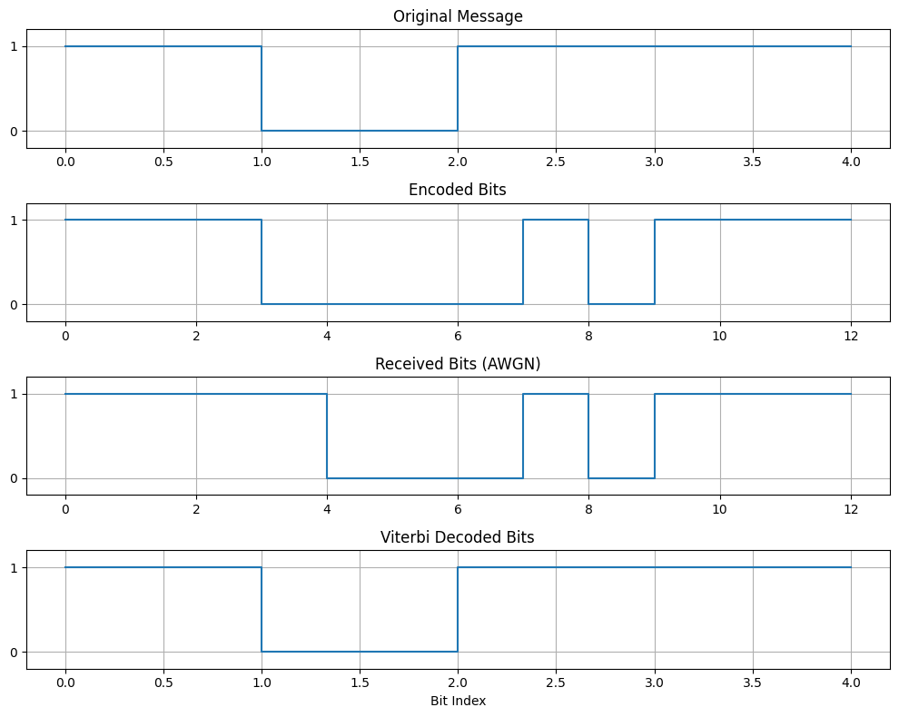

# 📡 Telecommunication Laboratory (ICT-4206)

[](https://www.mathworks.com/products/matlab.html)
[](https://www.python.org/)
[](https://jupyter.org/)
[](LICENSE)

This repository contains practical implementations, simulations, and laboratory experiments developed for:

**ICT-4206 – Telecommunication Laboratory**  
*Department of Information and Communication Technology, Islamic University, Bangladesh.*

---

## 📑 Table of Contents

- [📘 Overview & Objectives](#-overview--objectives)
- [📂 Repository Structure](#-repository-structure)
- [🧪 Laboratory Experiments & Theory](#-laboratory-experiments--theory)
  - [Exp 1: Pulse Code Modulation (PCM) & Demodulation](#exp-1-pulse-code-modulation-pcm--demodulation)
  - [Exp 6: Direct Sequence Spread Spectrum (DSSS)](#exp-6-direct-sequence-spread-spectrum-dsss)
  - [Exp 7: Frequency Hopping Spread Spectrum (FHSS)](#exp-7-frequency-hopping-spread-spectrum-fhss)
  - [Exp 12: (2, 1, 2) Convolutional Encoder](#exp-12-2-1-2-convolutional-encoder)
- [📊 Expected Benchmark Results](#-expected-benchmark-results)
- [🚀 How to Run the Experiments](#-how-to-run-the-experiments)
  - [Running MATLAB Scripts](#running-matlab-scripts)
  - [Running Python Scripts & Notebooks](#running-python-scripts--notebooks)
- [📚 Exam Preparation Guides](#-exam-preparation-guides)
- [⚖️ License & Academic Disclaimer](#-license--academic-disclaimer)

---

## 📘 Overview & Objectives

The **Telecommunication Laboratory** bridges fundamental analog/digital communication principles with modern computer simulation. Each experiment models the end-to-end signal flow—from transmitter processing and channel transmission to receiver detection and reconstruction.

### Key Competencies Developed
- **Digital Baseband Modulation:** Sampling, quantization, encoding, and low-pass filtering.
- **Spread Spectrum Systems:** Direct sequence spreading (DSSS) and pseudo-random frequency hopping (FHSS) for interference and jamming resistance.
- **Forward Error Correction (FEC):** Shift-register convolutional encoders, generator polynomials, state transitions, and termination bits.
- **Dual-Platform Implementation:** Identical theoretical models implemented in both **MATLAB** (`.m`) and **Python** (`.py` / `.ipynb`).

---

## 📂 Repository Structure

```
LabCodes/
├── MATLAB/                                # MATLAB source scripts and output plots
│   ├── Exp1_PCM.m                         # Pulse Code Modulation & Demodulation
│   ├── Exp1_PCM_Output.png
│   ├── Exp6_DSSS.m                        # Direct Sequence Spread Spectrum
│   ├── Exp6_DSSS_Output.png
│   ├── Exp7_FHSS.m                        # Frequency Hopping Spread Spectrum
│   ├── Exp7_FHSS_Output.png
│   ├── Exp12_ConvolutionalCodes.m         # (2, 1, 2) Convolutional Encoder
│   └── Exp12_ConvolutionalCodes_Output.png
│
├── Python/                                # Python scripts and interactive Jupyter notebooks
│   ├── Exp1_PCM.py
│   ├── Exp1_PCM.ipynb
│   ├── Exp6_DSSS.py
│   ├── Exp6_DSSS.ipynb
│   ├── Exp7_FHSS.py
│   ├── Exp7_FHSS.ipynb
│   ├── Exp12_ConvolutionalCodes.py
│   └── Exp12_ConvolutionalCodes.ipynb
│
├── Expected_Outputs/                      # Reference simulation waveforms for all experiments
│   ├── Exp1_PCM_Output.png
│   ├── Exp6_DSSS_Output.png
│   ├── Exp7_FHSS_Output.png
│   └── Exp12_ConvolutionalCodes_Output.png
│
├── EXPECTED_RESULTS.txt                   # Quick numerical verification benchmarks
├── Quick_Revision_One_Page.pdf            # 1-page high-yield lab exam summary
├── Telecom_Lab_Complete_Prep.pdf          # Full viva, theory, and calculation preparation guide
├── LICENSE                                # Apache 2.0 License
├── NOTICE                                 # Attribution notices
└── README.md                              # Main documentation
```

---

## 🧪 Laboratory Experiments & Theory

### Exp 1: Pulse Code Modulation (PCM) & Demodulation

**Aim:** To convert an analog message signal into a digital PCM bitstream through sampling, uniform quantization, and binary encoding, followed by low-pass reconstruction at the receiver.

#### Mathematical Foundation
1. **Sampling:** For message frequency $f_m$, the sampling rate must satisfy the Nyquist criterion:
   $$f_s \ge 2f_m$$
   Here: $f_m = 2\text{ Hz}$, $f_s = 100 \times f_m = 200\text{ Hz}$, $t \in [0, 1]\text{ s}$.
2. **Quantization:** An 8-level uniform quantizer ($L = 8$):
   $$n = \log_2(L) = 3\text{ bits/sample}$$
   Quantization levels: $\{-3.5, -2.5, -1.5, -0.5, +0.5, +1.5, +2.5, +3.5\}$.
3. **Encoding:** Each quantized level maps to a 3-bit binary codeword from `000` to `111`.
4. **Reconstruction:** A 6th-order Butterworth low-pass filter reconstructs the analog waveform from the decoded staircase levels.

#### Expected Output
- **PCM Bit Rate:** $R_b = n \cdot f_s = 3 \times 200 = 600\text{ bits/s}$.
- **First 12 Codewords:** `011 100 100 100 100 101 101 101 101 110 110 110`.
- **Quantization MSE:** $\approx 0.1005$.

#### Simulation Waveform Output


---

### Exp 6: Direct Sequence Spread Spectrum (DSSS)

**Aim:** To expand the baseband bandwidth of a digital bitstream using a high-rate Pseudo-Noise (PN) chip sequence, transmit via BPSK modulation, and recover the original message via coherent despreading.

#### Mathematical Foundation
1. **Spreading:** Each data bit $d_k \in \{0, 1\}$ is XORed with a 7-chip PN sequence:
   $$\text{Data} = [1, 0, 1], \quad \text{PN} = [0, 0, 1, 0, 1, 1, 1]$$
2. **Processing Gain ($PG$):**
   $$PG = \frac{T_b}{T_c} = N = 7 \implies PG_{\text{dB}} = 10\log_{10}(7) \approx 8.45\text{ dB}$$
3. **Modulation:** Polar conversion followed by BPSK carrier modulation.
4. **Despreading:** Synchronized multiplication by the identical local PN sequence collapses the spread signal back to the narrow message bandwidth.

#### Expected Output
- **Transmitted Data:** `[1, 0, 1]`.
- **Demodulated & Despread Data:** `[1, 0, 1]` (zero error in noiseless channel).

#### Simulation Waveform Output


---

### Exp 7: Frequency Hopping Spread Spectrum (FHSS)

**Aim:** To transmit digital data by pseudo-randomly shifting the carrier frequency across multiple discrete frequency channels, and recover the data using a synchronized local synthesizer.

#### Mathematical Foundation
1. **Frequency Hopping:** The carrier frequency $f_c(t)$ changes every bit interval according to a predefined hopping pattern across 7 distinct frequencies.
2. **Hop Frequencies (cycles/bit):** `[24, 3, 6, 1, 4, 12, 2, 24, 2, 6]`.
3. **Dehopping & Coherent Detection:** The receiver mixes the incoming signal with the synchronized local hop carrier to remove the hops, followed by matched filtering/thresholding.

#### Expected Output
- **Transmitted Bits:** `[1, 0, 1, 1, 0, 0, 1, 0, 1, 1]`.
- **Recovered Bits:** `[1, 0, 1, 1, 0, 0, 1, 0, 1, 1]`.

#### Simulation Waveform Output


---

### Exp 12: (2, 1, 2) Convolutional Encoder

**Aim:** To implement a rate-$1/2$ convolutional encoder using shift registers and modulo-2 (XOR) logic, observe the state transitions, and generate the serial code.

#### Mathematical Foundation
- **Code Rate ($R$):** $1/2$ (1 input bit produces 2 output bits: $c_1, c_2$).
- **Constraint Length ($K$):** $3$ ($1$ input bit + $2$ memory flip-flops $D_1, D_2$).
- **Generator Polynomials:**
  $$g_1 = 111_2 \implies c_1 = x \oplus D_1 \oplus D_2$$
  $$g_2 = 101_2 \implies c_2 = x \oplus D_2$$
- **Termination/Tail Bits:** Append $K - 1 = 2$ zeros to flush encoder memory back to state `00`.

#### Step-by-Step State Transition Table ($m = [1, 0, 1, 1]$ + Tail $[0, 0]$):

| Step | Input ($x$) | Initial State ($D_1 D_2$) | $c_1 = x \oplus D_1 \oplus D_2$ | $c_2 = x \oplus D_2$ | Output Pair ($c_1 c_2$) | Next State ($D_1 D_2$) |
| :---: | :---: | :---: | :---: | :---: | :---: | :---: |
| **1** | $1$ | `00` | $1 \oplus 0 \oplus 0 = 1$ | $1 \oplus 0 = 1$ | **11** | `10` |
| **2** | $0$ | `10` | $0 \oplus 1 \oplus 0 = 1$ | $0 \oplus 0 = 0$ | **10** | `01` |
| **3** | $1$ | `01` | $1 \oplus 0 \oplus 1 = 0$ | $1 \oplus 1 = 0$ | **00** | `10` |
| **4** | $1$ | `10` | $1 \oplus 1 \oplus 0 = 0$ | $1 \oplus 0 = 1$ | **01** | `11` |
| **5** | $0$ | `11` | $0 \oplus 1 \oplus 1 = 0$ | $0 \oplus 1 = 1$ | **01** | `01` |
| **6** | $0$ | `01` | $0 \oplus 0 \oplus 1 = 1$ | $0 \oplus 1 = 1$ | **11** | `00` |

- **Output Pairs:** `11  10  00  01  01  11`.
- **Serial Encoded Stream:** `111000010111`.

#### Simulation Waveform Output


---

## 📊 Expected Benchmark Results

| Experiment | Input Data | Generated / Transmitted Sequence | Output / Recovered Sequence | Key Metrics |
|---|---|---|---|---|
| **Exp 1: PCM** | $A=4\text{ V}, f_m=2\text{ Hz}$ | Uniform Quantized Staircase | Reconstructed Filtered Sine | $R_b = 600\text{ bps}, \text{MSE} \approx 0.1005$ |
| **Exp 6: DSSS** | `101` (3 bits) | 7-chip PN Spreading | `101` (3 bits) | $PG = 7\ (8.45\text{ dB}), \text{BER} = 0$ |
| **Exp 7: FHSS** | `1011001011` (10 bits) | 7-Carrier Frequency Hops | `1011001011` (10 bits) | 100% matched dehopping |
| **Exp 12: Conv Code** | `1011` + Tail `00` | State Matrix `00` $\to$ `00` | `111000010111` (12 bits) | Rate $1/2$, Constraint $K=3$ |

---

## 🚀 How to Run the Experiments

### Running MATLAB Scripts
All MATLAB scripts are located in the `MATLAB/` folder and do not require external toolboxes:
1. Open MATLAB.
2. Set the current directory to `LabCodes/MATLAB/`.
3. Open any script (e.g., `Exp1_PCM.m`) and press **Run** (<kbd>F5</kbd>).

Or run via the command line:
```bash
cd "MATLAB"
matlab -batch "run('Exp1_PCM.m')"
```

---

### Running Python Scripts & Notebooks

1. **Install Dependencies:**
   ```bash
   pip install numpy matplotlib scipy
   ```

2. **Execute Python Scripts:**
   ```bash
   cd "Python"
   python Exp1_PCM.py
   python Exp6_DSSS.py
   python Exp7_FHSS.py
   python Exp12_ConvolutionalCodes.py
   ```

3. **Open Interactive Jupyter Notebooks:**
   ```bash
   cd "Python"
   jupyter notebook
   ```
   Open any `.ipynb` file to interact with interactive widgets, formulas, and plotted waveforms.

---

## 📚 Exam Preparation Guides

The repository includes high-yield study materials tailored for practical examinations and viva-voce:

- 📄 **[Quick_Revision_One_Page.pdf](Quick_Revision_One_Page.pdf):** 1-page condensed revision sheet with all equations, block diagrams, parameter values, and outputs.
- 📖 **[Telecom_Lab_Complete_Prep.pdf](Telecom_Lab_Complete_Prep.pdf):** Comprehensive manual containing full theoretical discussions, derivation steps, viva Q&A, and signal analysis.
- 📋 **[EXPECTED_RESULTS.txt](EXPECTED_RESULTS.txt):** Quick terminal reference for checking output numbers during lab tests.

---

## ⚖️ License & Academic Disclaimer

- **License:** Licensed under the [Apache License 2.0](LICENSE).
- **Academic Disclaimer:** This repository is intended strictly for educational, research, and laboratory learning purposes.
- **Attribution:** If using this work for coursework or reference, please provide attribution to the original repository:
  ```
  https://github.com/SajjadHossainSoykot/ICT-4206-Telecommunication-Laboratory
  ```